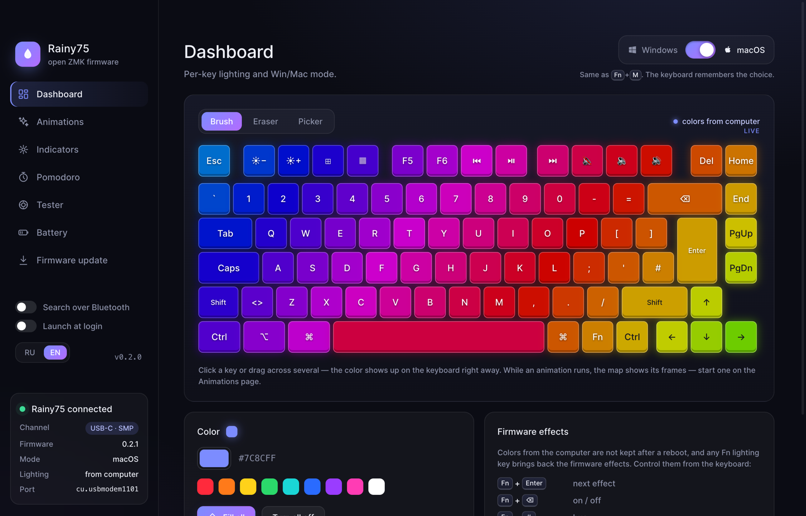
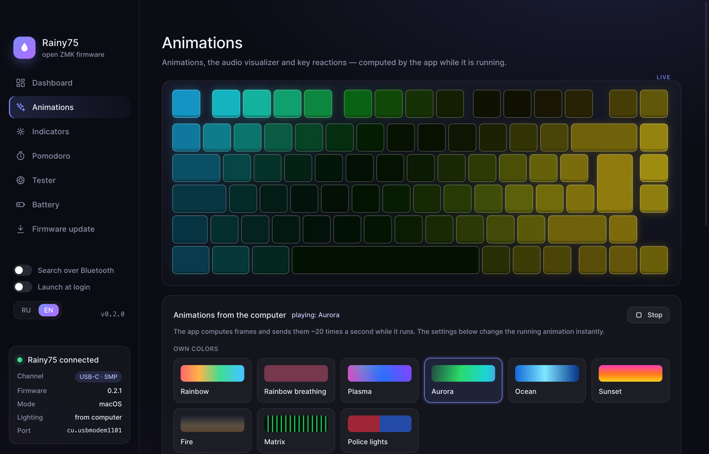
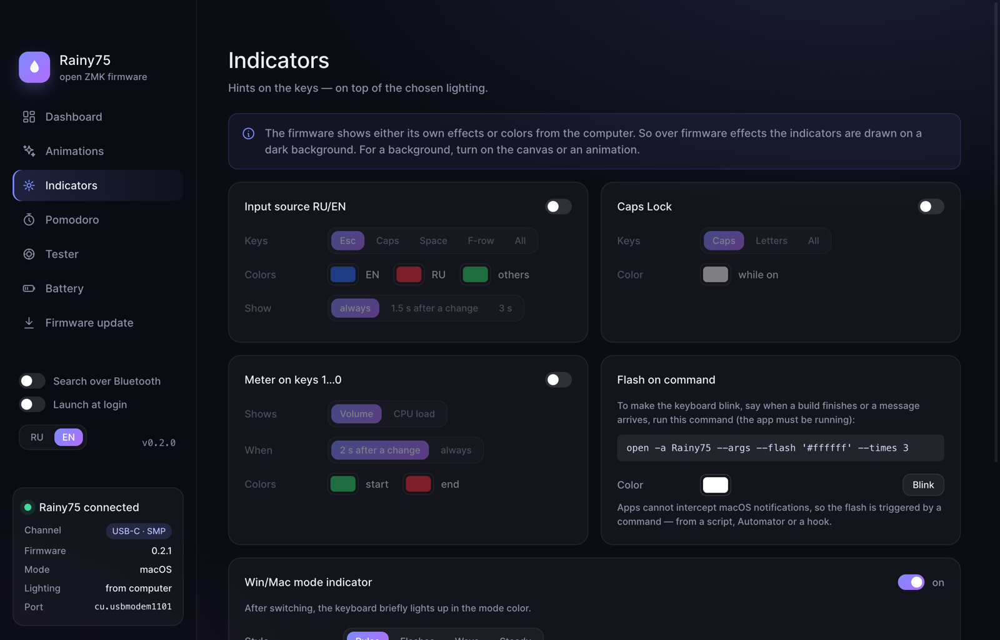
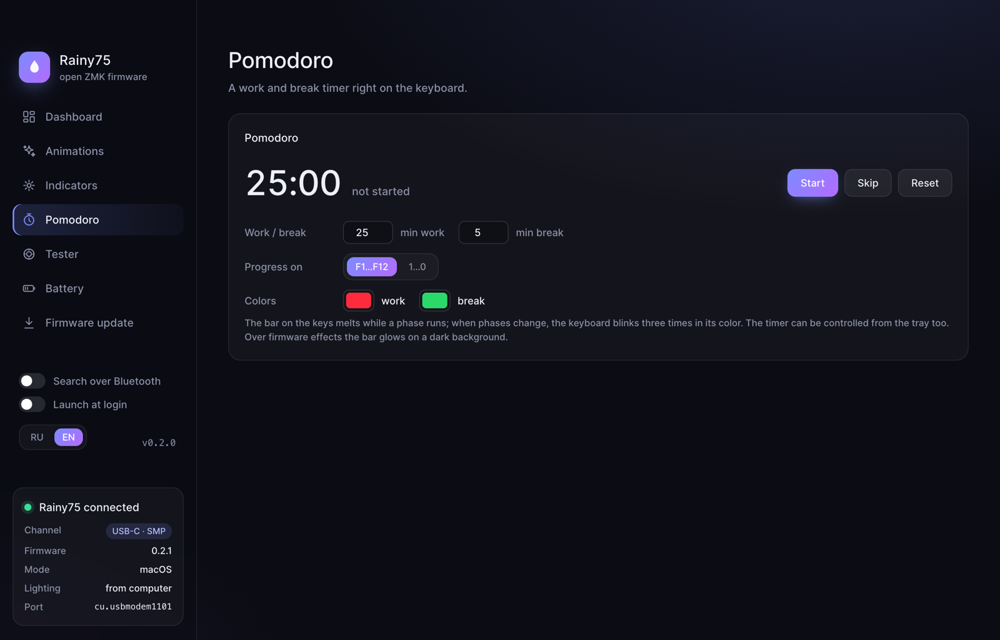
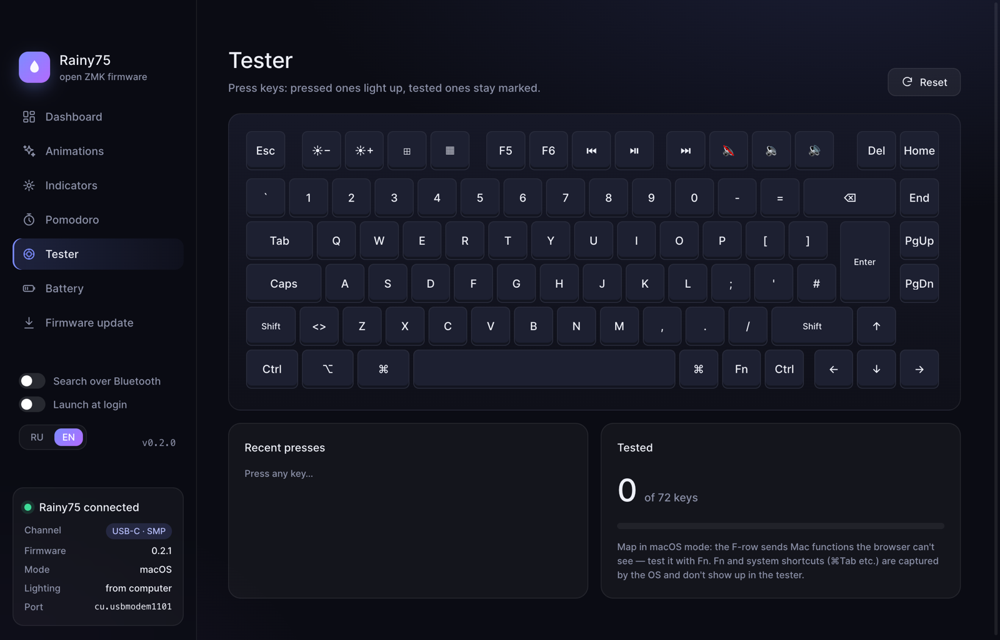
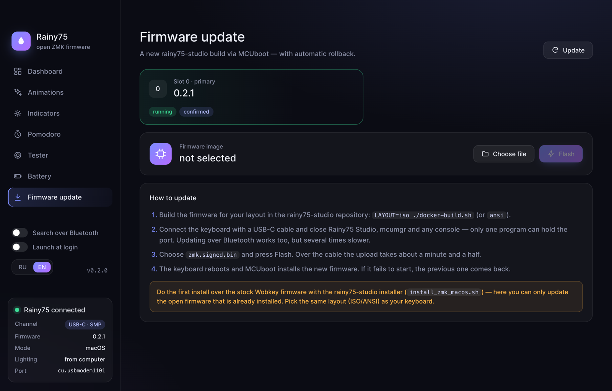

<div align="center">


# Rainy75 ZMK App

**Control panel for the Wobkey Rainy75 Pro running open-source ZMK firmware**

Per-key lighting, animations, an audio visualizer, indicators, a pomodoro timer and firmware updates — without ZMK Studio or the vendor software.

[](https://github.com/pavel-one/rainy75-zmk-app/releases/latest)
[](https://github.com/pavel-one/rainy75-zmk-app/actions/workflows/release.yml)
[](https://github.com/pavel-one/rainy75-zmk-app/actions/workflows/test.yml)
[](https://github.com/pavel-one/rainy75-zmk-app/releases)
<br>
[](https://go.dev)
[](https://v3.wails.io)
[](https://www.typescriptlang.org)
[](https://zmk.dev)
[](#install)

[Features](#features) · [Install](#install) · [Firmware](#firmware) · [Build](#build) · [Structure](#structure)

[Русский](README.ru.md) · **English**

</div>

---

<p align="center">
  
</p>

## Features

| | |
|---|---|
| 🎨 **Canvas** | Color every key: brush, eraser, picker, fill. The map in the window mirrors what is lit on the keyboard |
| ✨ **Animations** | 21 effects computed by the app: hue shift, saturation, your own colors, speed — all live |
| 🔊 **Audio visualizer** | System audio spectrum as bars across the whole keyboard |
| ⌨️ **Key reactions** | Ripples, trail, cross, heat map |
| 🚦 **Indicators** | Input source RU/EN, Caps Lock, volume or CPU load on the number row, Win/Mac mode |
| 🍅 **Pomodoro** | A timer right on the F-row, a flash when phases change |
| 💡 **Flash on command** | `rainy75 --flash '#ff0000' --times 3` — blink the keyboard from a script or hook |
| 🔁 **Win / Mac** | Same as `Fn`+`M`: the firmware switches the layer and remembers it |
| 📶 **Bluetooth** | Works without a cable through the SMP GATT service |
| 🔋 **Battery** | Keyboard charge from the OS |
| ⬆️ **Firmware update** | The image goes to the second MCUboot slot and rolls back if it fails to boot |
| 🧪 **Tester** | Check every key with macOS and Windows legends |
| 🗂 **Tray and autostart** | Mode, effects, pomodoro and autostart from the tray menu |
| 🌍 **English and Russian** | The interface and tray menu switch on the fly; the system language is the default |
| 🔄 **App updates** | New versions from GitHub Releases install in one click and the app restarts itself |

## Tour

### Dashboard

The main screen is a live keyboard map. While an animation runs, it shows its frames; otherwise it's a canvas: pick the brush and a color, click a key or drag across several, and the color shows up on the keyboard right away. The eraser turns keys off, the picker grabs a color from a painted key. Below are the palette, fill-all and a cheat sheet for the firmware Fn lighting keys. The **Windows / macOS** switch works like `Fn`+`M`: the firmware switches the layer and remembers the choice. The sidebar shows the connection: channel (USB-C or Bluetooth), firmware version, mode and what is lit right now.

### Animations



21 animations computed by the app and sent to the keyboard ~20 times a second: rainbow, plasma, aurora, ocean, fire, matrix, comets, stars, rain, spiral and more. Effects with their own palette can be rotated around the hue wheel and desaturated, the others take one or two colors. Speed and brightness change live without restarting the animation, and the settings are remembered between launches.

On the same page:

- **Audio visualizer** — the spectrum of whatever plays on the system, as bars across the keyboard;
- **Key reactions** — ripples, trail, cross or heat map on top of any lighting; a single color or a rainbow (a new color for every press), fade time.

### Indicators



Hints drawn on top of the chosen lighting:

- **Input source RU/EN** — the current language color on Esc, Caps, Space, the F-row or all keys; always or for a couple of seconds after a change;
- **Caps Lock** — while it's on, the key itself, all letters or the whole keyboard light up;
- **Meter on keys 1…0** — volume or CPU load, always or for 2 seconds after a change;
- **Flash on command** — the keyboard blinks when a script, build or hook runs `rainy75 --flash '#ff0000' --times 3`;
- **Win/Mac mode** — after switching, the keyboard briefly lights up in the mode color: pulse, flashes, wave or steady.

### Pomodoro



A work and break timer right on the keyboard: a bar on the F-row or the number row melts while a phase runs, and the keyboard blinks three times in the phase color when it changes. Phase lengths and colors are configurable, and the timer can be controlled from the tray too.

### Tester



A map built from the `rainy75.dts` geometry with legends for the current mode. Pressed keys light up, tested ones stay marked, and next to it are the recent presses with key codes and a tested-keys counter.

### Firmware update



Shows the MCUboot slots and the firmware version. Choose `zmk.signed.bin` — the app checks the image header, writes it to the second slot, marks it for a test boot and reboots the keyboard. If the new firmware fails to start, MCUboot brings back the previous one. Works over the cable and over Bluetooth.

### Tray

The tray icon shows the current mode (Mac/Win). From the menu you can switch the mode, restore firmware effects, control the pomodoro and autostart. At login the app starts straight into the tray, without a window.

### Language and updates

At the bottom of the sidebar there is an **RU / EN** switch and the version number. On first launch the language follows the system; the choice is saved in the settings and applied to the window and tray menu at once.

The app checks [GitHub releases](https://github.com/pavel-one/rainy75-zmk-app/releases) on its own — at launch and every 6 hours, or right away when you click the version number. When a new version is out, a card appears in the sidebar: **Update** downloads the build for your OS, puts it in place of the current one and restarts the app; **What's new** opens the release notes. If the app folder isn't writable, the app suggests downloading the update manually.

## Install

Builds are on the [Releases](https://github.com/pavel-one/rainy75-zmk-app/releases/latest) page:

| OS | File |
|---|---|
| macOS (Apple Silicon and Intel) | `rainy75-macos-universal.zip` |
| Windows x64 | `rainy75-windows-amd64.zip` |
| Linux x64 | `rainy75-linux-amd64.tar.gz` or `.deb` |

The builds are not signed. On macOS, remove the quarantine flag after unpacking:

```bash
xattr -dr com.apple.quarantine Rainy75.app
```

Linux needs GTK 4 and WebKitGTK 6.0 (Ubuntu 24.04+, Debian 13+).

> [!NOTE]
> Bluetooth, the audio visualizer, key reactions, input source, Caps Lock, CPU and volume work on macOS only for now (the visualizer needs 14.2+).
> Lighting, animations, pomodoro, Win/Mac mode, the tester and firmware updates over the cable work on every OS.

## Firmware

The app targets the open-source [rainy75-studio](https://github.com/Code-Wizard-Wilson/rainy75-studio) firmware — a ZMK port for the Rainy75 Pro (by Code-Wizard-Wilson, Apache-2.0).

| | |
|---|---|
| Controller | Telink TLSR9511 (B91, RISC-V), 1 MB flash |
| Layouts | ISO and ANSI, 83 keymap positions |
| Connection | USB-C and Bluetooth LE, three profiles. The 2.4 GHz dongle **does not work** |
| Modes | macOS by default, Windows as layer 2 on top of the base |
| Updates | MCUboot with rollback |
| USB | `Rainy 75 Pro`, VID:PID `1D50:615E` |

The firmware talks to the computer over **SMP (mcumgr)** through the USB CDC ACM serial port or over Bluetooth:

- `0` — OS (reboot), `1` — firmware images;
- `65` (`rgb_mgmt`) — key colors, fill, a full 83-color frame, Win/Mac mode;
- `64` (`flash_mgmt`) — raw flash access; the app **never touches** it.

A dedicated USB interface (raw HID, say) doesn't fit into the B91 endpoint memory: USB stops enumerating and only a programmer can bring the keyboard back. That's why everything goes through the existing CDC ACM port.

Only one program can hold the port — close Rainy75 Studio, `mcumgr` and any serial console first. The first ZMK install and going back to the stock firmware are done with the rainy75-studio scripts.

<details>
<summary>Firmware lighting keys</summary>

Colors from the computer don't survive a keyboard reboot, and any Fn lighting key brings back the firmware effects.

| Keys | Action |
|---|---|
| `Fn`+`Enter` | next effect |
| `Fn`+`⌫` | lighting on/off |
| `Fn`+`#` | hue |
| `Fn`+`↑` / `↓` | brightness |
| `Fn`+`←` / `→` | speed |
| `Fn`+`B` | battery indicator |

</details>

<details>
<summary>macOS permissions</summary>

System Settings → Privacy & Security:

- **Input Monitoring** — key reactions;
- **System Audio Recording** — the visualizer;
- **Bluetooth** — working without a cable.

</details>

## Build

You need Go 1.26+, Node.js 22+ and [Wails v3](https://v3.wails.io).

```bash
go install github.com/wailsapp/wails/v3/cmd/wails3@v3.0.0
cd app
wails3 dev      # development with hot reload
wails3 build    # binary in app/bin
go test ./internal/... .
```

Releases build themselves: push an annotated `vX.Y.Z` tag and GitHub Actions builds the app for macOS, Windows and Linux, stamps the version and uploads the archives to Releases. The tag annotation becomes the release notes:

```bash
git tag -a v0.3.0 --cleanup=whitespace -F notes.md
git push origin v0.3.0
```

`--cleanup=whitespace` keeps Markdown headings — by default git drops lines starting with `#`.

## Structure

```
app/
├── main.go, tray.go          window, tray, launch flags
├── keyboard_service.go       connection, Win/Mac mode, battery, firmware
├── lighting_service.go       lighting, indicators, visualizer, pomodoro
├── update_service.go         checking and installing updates
├── internal/
│   ├── smp                   SMP client: serial (base64 + CRC16) and Bluetooth, CBOR
│   ├── ble                   SMP over Bluetooth via CoreBluetooth
│   ├── device                finding the keyboard port
│   ├── rainy                 firmware commands: group 65, MCUboot
│   ├── layout                83 positions, key geometry and legends
│   ├── effects               animations
│   ├── lights                frame compositor: base and indicator layers
│   ├── host                  system data: key presses, input source, CPU, audio
│   ├── indicator             Win/Mac mode indicator
│   ├── settings              settings.json
│   ├── i18n                  app string translations (the key is the Russian text)
│   ├── update                GitHub releases, download and in-place replacement
│   └── battery, autostart
└── frontend/                 TypeScript + Vite UI, dictionary in src/en.ts
json/                         stock firmware layout descriptions (VIA)
```
