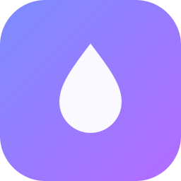
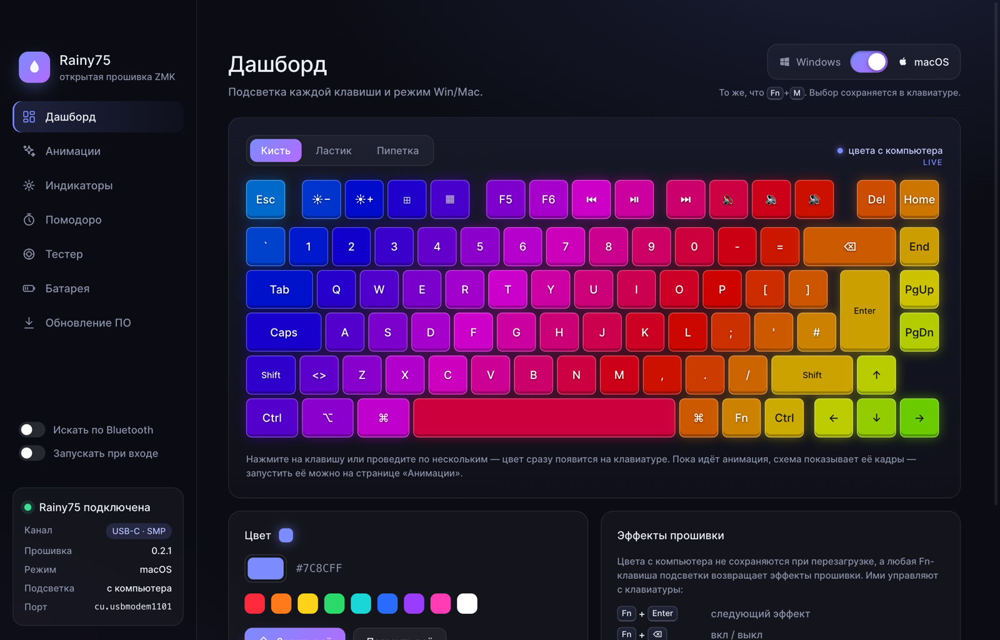
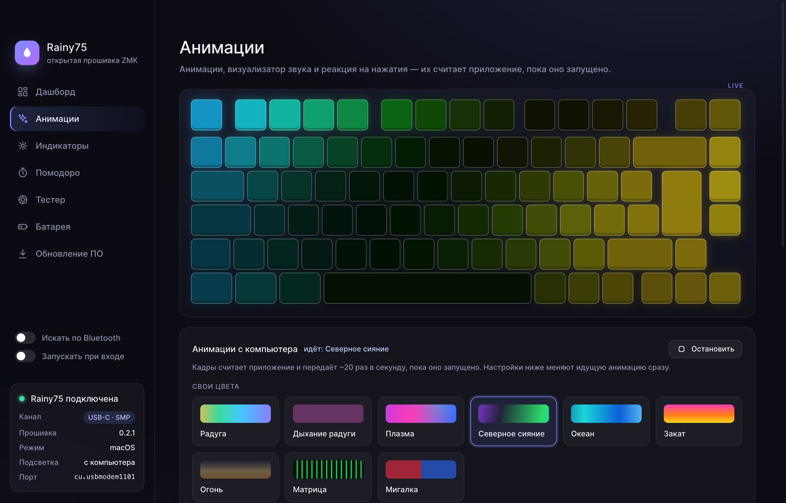
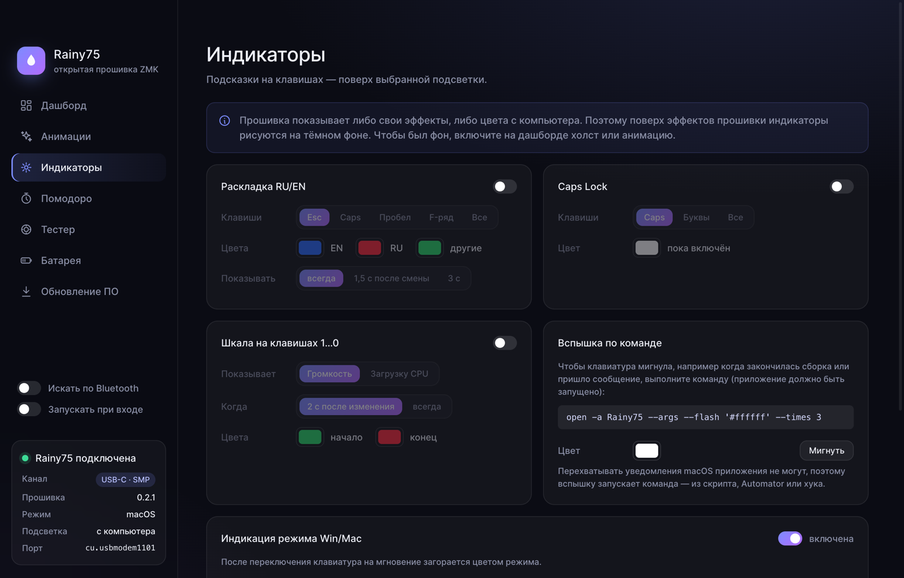
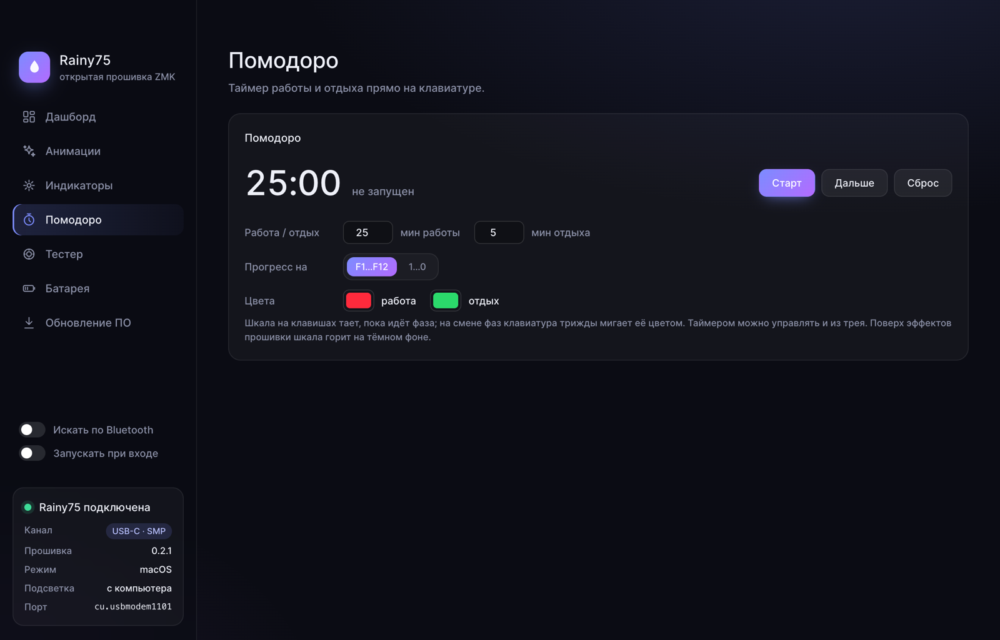
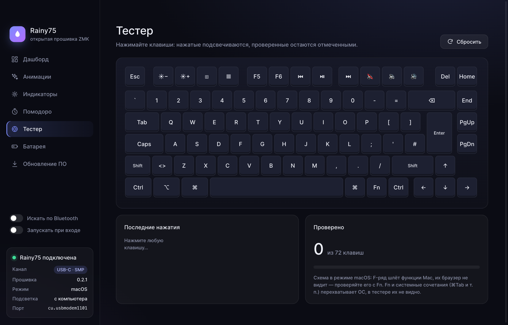
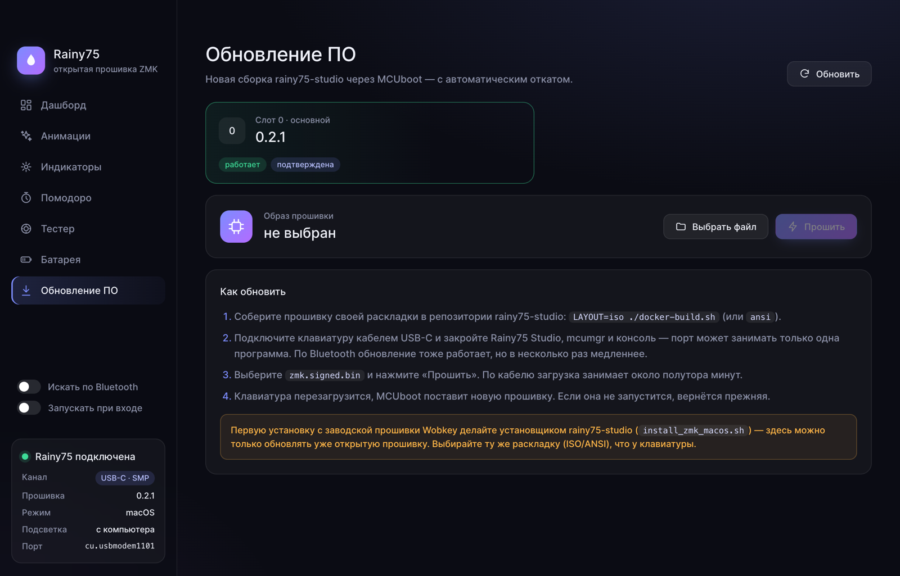

<div align="center">



# Rainy75 ZMK App

**Панель управления для Wobkey Rainy75 Pro с открытой прошивкой ZMK**

Подсветка каждой клавиши, анимации, визуализатор звука, индикаторы, помодоро и обновление прошивки — без ZMK Studio и фирменного софта.

[](https://github.com/pavel-one/rainy75-zmk-app/releases/latest)
[](https://github.com/pavel-one/rainy75-zmk-app/actions/workflows/release.yml)
[](https://github.com/pavel-one/rainy75-zmk-app/actions/workflows/test.yml)
[](https://github.com/pavel-one/rainy75-zmk-app/releases)
<br>
[](https://go.dev)
[](https://v3.wails.io)
[](https://www.typescriptlang.org)
[](https://zmk.dev)
[](#установка)

[Возможности](#возможности) · [Установка](#установка) · [Прошивка](#прошивка) · [Сборка](#сборка) · [Устройство](#устройство)

**Русский** · [English](README.md)

</div>

---

<p align="center">
  
</p>

## Возможности

| | |
|---|---|
| 🎨 **Холст** | Цвет каждой клавиши: кисть, ластик, пипетка, заливка. Схема в окне повторяет то, что горит на клавиатуре |
| ✨ **Анимации** | 21 эффект, который считает приложение: сдвиг оттенка, насыщенность, свои цвета, скорость — всё меняется на лету |
| 🔊 **Визуализатор звука** | Спектр звука системы столбиками по всей клавиатуре |
| ⌨️ **Реакция на нажатия** | Круги, след, крест, тепловая карта |
| 🚦 **Индикаторы** | Раскладка RU/EN, Caps Lock, громкость или загрузка CPU на ряду цифр, режим Win/Mac |
| 🍅 **Помодоро** | Таймер прямо на F-ряду, вспышка на смене фаз |
| 💡 **Вспышка по команде** | `rainy75 --flash '#ff0000' --times 3` — мигнуть клавиатурой из скрипта или хука |
| 🔁 **Win / Mac** | То же, что `Fn`+`M`: прошивка переключает слой и запоминает выбор |
| 📶 **Bluetooth** | Работает без кабеля через GATT-сервис SMP |
| 🔋 **Батарея** | Заряд клавиатуры из ОС |
| ⬆️ **Обновление прошивки** | Образ пишется во второй слот MCUboot, при неудачном запуске прошивка откатывается |
| 🧪 **Тестер** | Проверка всех клавиш с подписями под macOS и Windows |
| 🗂 **Трей и автозапуск** | Режим, эффекты, помодоро и автозапуск из меню в трее |
| 🌍 **Русский и английский** | Язык интерфейса и меню трея переключается на лету, по умолчанию — язык системы |
| 🔄 **Обновление приложения** | Новые версии с GitHub Releases ставятся в один клик, приложение перезапускается само |

## Обзор

### Дашборд

Главный экран — живая схема клавиатуры. Пока идёт анимация, схема показывает её кадры; в остальное время это холст: выберите кисть и цвет, нажмите на клавишу или проведите по нескольким — цвет сразу появится на клавиатуре. Ластик гасит клавиши, пипетка берёт цвет с уже раскрашенной. Под схемой — палитра, заливка всей клавиатуры и шпаргалка по Fn-клавишам подсветки прошивки. Переключатель **Windows / macOS** в углу работает как `Fn`+`M`: прошивка меняет слой и запоминает выбор. Слева — состояние подключения: канал (USB-C или Bluetooth), версия прошивки, режим и что сейчас горит.

### Анимации



21 анимация, которую считает приложение и отправляет в клавиатуру ~20 раз в секунду: радуга, плазма, северное сияние, океан, огонь, матрица, кометы, звёзды, дождь, спираль и другие. У «своих» эффектов можно повернуть палитру по кругу оттенков и приглушить насыщенность, у остальных — задать один или два цвета. Скорость и яркость меняются на лету, без перезапуска анимации; параметры запоминаются между запусками.

На этой же странице:

- **Визуализатор звука** — спектр того, что играет в системе, столбиками по всей ширине клавиатуры;
- **Реакция на нажатия** — круги, след, крест или тепловая карта поверх любой подсветки; свой цвет или радуга (каждое нажатие — своим цветом), время затухания.

### Индикаторы



Подсказки, которые рисуются поверх выбранной подсветки:

- **Раскладка RU/EN** — цвет текущего языка на Esc, Caps, пробеле, F-ряду или всех клавишах; всегда или пару секунд после смены;
- **Caps Lock** — пока включён, горит сама клавиша, все буквы или вся клавиатура;
- **Шкала на клавишах 1…0** — громкость или загрузка процессора, постоянно или 2 секунды после изменения;
- **Вспышка по команде** — клавиатура мигает, когда скрипт, сборка или хук выполнят `rainy75 --flash '#ff0000' --times 3`;
- **Режим Win/Mac** — после переключения клавиатура на мгновение загорается цветом режима: пульс, вспышки, волна или ровный свет.

### Помодоро



Таймер работы и отдыха прямо на клавиатуре: шкала на F-ряду или цифрах тает, пока идёт фаза, а на смене фаз клавиатура трижды мигает её цветом. Длительность фаз и цвета настраиваются, управлять таймером можно и из трея.

### Тестер



Схема по геометрии из `rainy75.dts` с подписями под текущий режим. Нажатые клавиши подсвечиваются, проверенные остаются отмеченными, рядом — журнал последних нажатий с кодами и счётчик проверенных клавиш.

### Обновление прошивки



Показывает слоты MCUboot и версию прошивки. Выберите `zmk.signed.bin` — приложение проверит заголовок образа, запишет его во второй слот, пометит для пробного запуска и перезагрузит клавиатуру. Если новая прошивка не запустится, MCUboot вернёт прежнюю. Работает по кабелю и по Bluetooth.

### Трей

Значок в трее показывает текущий режим (Mac/Win). Из меню можно переключить режим, вернуть эффекты прошивки, управлять помодоро и автозапуском. При входе в систему приложение запускается сразу в трей, без окна.

### Язык и обновления

Внизу боковой панели — переключатель **RU / EN** и номер версии. При первом запуске язык берётся из системы, выбор сохраняется в настройках и сразу применяется к окну и меню трея.

Приложение само проверяет [релизы на GitHub](https://github.com/pavel-one/rainy75-zmk-app/releases) — при запуске и раз в 6 часов, а по клику на номер версии — сразу. Когда выходит новая версия, в боковой панели появляется карточка: **Обновить** скачивает сборку под вашу ОС, ставит её на место текущей и перезапускает приложение, **Что нового** открывает описание релиза. Если папка с приложением недоступна для записи, приложение предложит скачать обновление вручную.

## Установка

Готовые сборки лежат на странице [Releases](https://github.com/pavel-one/rainy75-zmk-app/releases/latest):

| ОС | Файл |
|---|---|
| macOS (Apple Silicon и Intel) | `rainy75-macos-universal.zip` |
| Windows x64 | `rainy75-windows-amd64.zip` |
| Linux x64 | `rainy75-linux-amd64.tar.gz` или `.deb` |

Сборки не подписаны. На macOS после распаковки снимите карантин:

```bash
xattr -dr com.apple.quarantine Rainy75.app
```

На Linux нужны GTK 4 и WebKitGTK 6.0 (Ubuntu 24.04+, Debian 13+).

> [!NOTE]
> Bluetooth, визуализатор звука, реакция на нажатия, раскладка, Caps Lock, CPU и громкость пока работают только на macOS (визуализатор — с 14.2).
> Подсветка, анимации, помодоро, режим Win/Mac, тестер и обновление прошивки по кабелю — на всех ОС.

## Прошивка

Приложение рассчитано на открытую прошивку [rainy75-studio](https://github.com/Code-Wizard-Wilson/rainy75-studio) — порт ZMK на Rainy75 Pro (автор Code-Wizard-Wilson, Apache-2.0).

| | |
|---|---|
| Контроллер | Telink TLSR9511 (B91, RISC-V), 1 МБ flash |
| Раскладки | ISO и ANSI, 83 позиции keymap |
| Подключение | USB-C и Bluetooth LE, три профиля. Приёмник 2.4 ГГц **не работает** |
| Режимы | macOS по умолчанию, Windows — слой 2 поверх базового |
| Обновление | MCUboot с откатом |
| USB | `Rainy 75 Pro`, VID:PID `1D50:615E` |

С компьютером прошивка общается по **SMP (mcumgr)** через последовательный порт USB CDC ACM или по Bluetooth:

- `0` — ОС (перезагрузка), `1` — образы прошивки;
- `65` (`rgb_mgmt`) — цвета клавиш, заливка, полный кадр из 83 цветов, режим Win/Mac;
- `64` (`flash_mgmt`) — сырой доступ к flash; приложение его **не трогает**.

Свой USB-интерфейс (например, raw HID) у B91 не помещается в память эндпоинтов: USB перестаёт определяться, и вернуть клавиатуру можно только программатором. Поэтому всё идёт через уже существующий порт CDC ACM.

Порт может занимать только одна программа — перед запуском закройте Rainy75 Studio, `mcumgr` и последовательную консоль. Первая установка ZMK и возврат к заводской прошивке делаются скриптами rainy75-studio.

<details>
<summary>Клавиши подсветки прошивки</summary>

Цвета с компьютера не переживают перезагрузку клавиатуры, а любая Fn-клавиша подсветки возвращает эффекты прошивки.

| Клавиши | Действие |
|---|---|
| `Fn`+`Enter` | следующий эффект |
| `Fn`+`⌫` | подсветка вкл/выкл |
| `Fn`+`#` | оттенок |
| `Fn`+`↑` / `↓` | яркость |
| `Fn`+`←` / `→` | скорость |
| `Fn`+`B` | индикатор заряда |

</details>

<details>
<summary>Разрешения macOS</summary>

Системные настройки → Конфиденциальность и безопасность:

- **Мониторинг ввода** — реакция на нажатия;
- **Запись звука системы** — визуализатор;
- **Bluetooth** — работа без кабеля.

</details>

## Сборка

Нужны Go 1.26+, Node.js 22+ и [Wails v3](https://v3.wails.io).

```bash
go install github.com/wailsapp/wails/v3/cmd/wails3@v3.0.0
cd app
wails3 dev      # разработка с hot reload
wails3 build    # бинарник в app/bin
go test ./internal/... .
```

Релиз собирается сам: достаточно запушить аннотированный тег `vX.Y.Z` — GitHub Actions соберёт приложение под macOS, Windows и Linux, подставит версию и выложит архивы в Releases. Текст аннотации тега становится описанием релиза.

## Устройство

```
app/
├── main.go, tray.go          окно, трей, флаги запуска
├── keyboard_service.go       подключение, режим Win/Mac, батарея, прошивка
├── lighting_service.go       подсветка, индикаторы, визуализатор, помодоро
├── update_service.go         проверка и установка обновлений
├── internal/
│   ├── smp                   клиент SMP: serial (base64 + CRC16) и Bluetooth, CBOR
│   ├── ble                   SMP по Bluetooth через CoreBluetooth
│   ├── device                поиск порта клавиатуры
│   ├── rainy                 команды прошивки: группа 65, MCUboot
│   ├── layout                83 позиции, геометрия и подписи клавиш
│   ├── effects               анимации
│   ├── lights                компоновщик кадров: база и слои-индикаторы
│   ├── host                  данные системы: нажатия, раскладка, CPU, звук
│   ├── indicator             индикация режима Win/Mac
│   ├── settings              settings.json
│   ├── i18n                  перевод строк приложения (ключ — русский текст)
│   ├── update                релизы GitHub, скачивание и подмена приложения
│   └── battery, autostart
└── frontend/                 интерфейс на TypeScript + Vite, словарь в src/en.ts
json/                         описания раскладок заводской прошивки (VIA)
```
